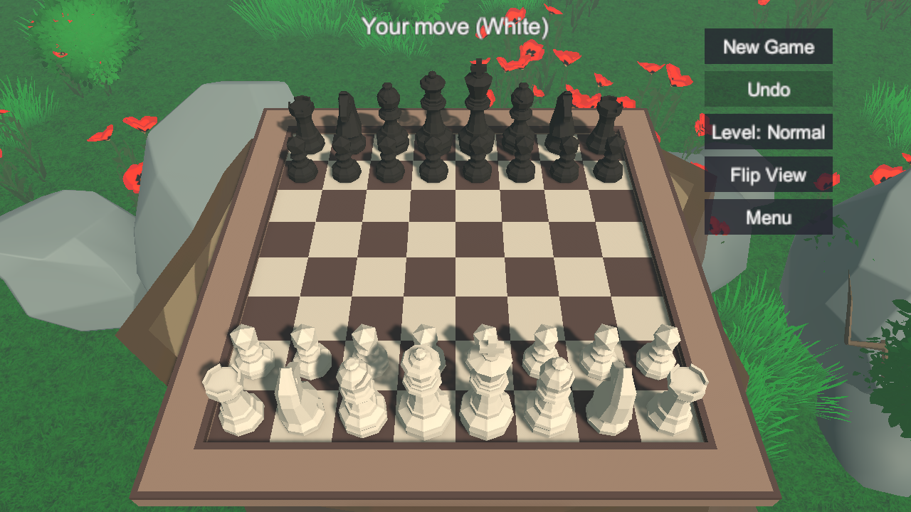

# Chess3DUnity

A single-player 3D chess game. Play White or Black against a built-in AI, on a board standing on a giant tree stump in
a forest. Built with Unity 6 (URP) and low-poly assets; the rules engine is plain C#, separate from Unity, and was
developed test-first.

เกมหมากรุกสากล 3 มิติแบบเล่นคนเดียว สู้กับ AI บนกระดานที่ตั้งอยู่บนขอนไม้ใหญ่กลางป่า สร้างด้วย Unity 6 (URP)
(สรุปภาษาไทยอยู่ท้ายไฟล์)



## The game

Standard international chess against the computer. You choose the difficulty and which colour to play; the AI plays
the other side.

**Rules implemented** (checked against published perft node counts for five standard positions):

- All piece moves, check, checkmate and stalemate
- Castling both ways, en passant, and pawn promotion where *you* pick the piece (queen, rook, bishop or knight)
- Draws by threefold repetition, the 50-move rule, and insufficient material (bare kings, a lone knight or bishop,
  or bishops that all stand on one colour)

**The AI** is a depth-limited negamax search with alpha-beta pruning. It scores material plus a small bonus for
central knights and bishops and for advanced pawns. It is not a strong engine; it is meant to be a fair opponent:

| Level  | Search depth | Plays a random move within |
|--------|--------------|----------------------------|
| Easy   | 1 ply        | 0.6 pawn of the best       |
| Normal | 3 plies      | 0.15 pawn of the best      |
| Hard   | 4 plies      | exact ties only            |

Moves of equal value are chosen at random, so games differ. The AI avoids a move that would draw the game when it is
ahead, and takes one when it is behind. If it has a checkmate in one, it plays it.

## Starting and playing

The game opens on a title screen with **Start Game** and **Exit Game**. **Start Game** opens a setup screen: pick the
difficulty (Easy / Normal / Hard) and the colour you play (White / Black), then **Play**. Your choices are remembered
for next time. If you play Black, the camera moves to Black's side and the AI opens.

### Controls

| Action | How |
|---|---|
| Move | Click a piece, then a highlighted square: **green** dot = move, **red** square = capture |
| Choose a promotion piece | A Queen / Rook / Bishop / Knight picker appears. Click the board instead to cancel |
| Turn the camera round the board | **A / D** or **Left / Right**, or hold the right mouse button and drag sideways |
| Tilt the camera | **W / S** or **Up / Down**, or right-drag up and down. The lowest is level with the board, so you never see under it |
| Swing to the other side | **Flip View** |
| Take back your last move (and the AI's reply) | **Undo** |
| Restart with the same settings | **New Game** |
| Change the AI level mid-game | **Level** (cycles Easy / Normal / Hard) |
| Back to the title screen | **Menu** |

### What you see

- Status line: whose move it is, **Check!**, and the result (checkmate, stalemate, or which draw rule applied)
- The last move is ringed in **orange**; a king in check is ringed in **red**
- The game so far in standard notation at the top left (`1. e4 e5  2. Nf3 Nc6 ...`)
- Pieces slide to their squares; a capture throws up debris and plays a heavier thump than a plain move (the sounds
  are generated in code, there are no audio files)

## Running it

The paid / licensed assets are **not** in this repository, so you import them yourself:

1. Open the project with **Unity 6000.4.9f1** (Universal Render Pipeline).
2. Import **Low Poly Chess Pack** by Broken Vector from the Asset Store (board and pieces). The pack ships a Built-in
   pipeline material; open `Assets/BrokenVector/LowpolyChessPack/Materials/Chess Material.mat` and switch its shader
   to **Universal Render Pipeline/Lit**, moving `_MainTex` to `_BaseMap`. Otherwise the board renders magenta.
3. Import **Low Poly Environment - Nature Free** by Polytope Studio (the forest). Then also import
   `Assets/Polytope Studio/Lowpoly_Environments/URP/PT_Nature_Free_URP_17.unitypackage`; without it the foliage
   shaders are Built-in only.
4. Run **Chess > Build Scene** from the menu bar. It assembles `Assets/Scenes/Main.unity`: the board, the pieces, the
   stump, ground, trees and undergrowth, mist and light. The forest uses a fixed random seed, so rebuilding always
   gives the same layout.
5. Open `Assets/Scenes/Main.unity` and press **Play**.

## Project layout

```
Assets/Chess/
  Core/        Rules and AI. Plain C#, no UnityEngine reference (its own assembly: Chess.Core)
    Board.cs     Position, FEN, applying a move, repetition key, insufficient material
    MoveGen.cs   Pseudo-legal and legal moves, check detection, game status
    Notation.cs  Standard algebraic notation (Nf3, exd5, O-O, e8=Q+, Qh4#)
    Ai.cs        Negamax with alpha-beta, random choice among near-equal moves
    Game.cs      One game: whose turn, undo, draw rules, the move list
  Runtime/     The Unity front end (Chess.Runtime)
    ChessView.cs   Pieces, clicks, camera, highlights, sound, effects, in-game UI
    StartMenu.cs   Title and setup screens and the small UI helpers
  Tests/       EditMode tests for everything in Core (NUnit)
  PlayTests/   PlayMode tests that load the real scene and click through it
Assets/Editor/SetupScene.cs   The "Chess > Build Scene" command
DotnetTests/                  Runs the Core tests without opening the editor
```

The rules engine knows nothing about Unity, so its tests run in plain .NET in about a second. `ChessView` stays thin:
it turns clicks into squares, asks `Game` what is legal, and redraws the pieces by comparing the board before and
after a move, so castling, en passant and promotion need no special code in the view.

## Tests

```bash
dotnet test DotnetTests
```

runs the 190 Core tests (the same files Unity's EditMode runner uses). They include perft node counts for the
starting position and Kiwipete plus three other standard positions, notation examples, every draw rule, undo, and the
AI (mate-in-one, free pieces, avoiding poisoned captures, variety, drawing behaviour).

In Unity: **Window > General > Test Runner**, EditMode for the 190 and PlayMode for the 28 scene tests. The PlayMode
tests load `Main.unity`, drive the start menu, click through moves, promotions, undo, camera moves and captures, check
the forest around the board, and save screenshots to `Logs/shots/`. From a terminal:

```bash
Unity.exe -batchmode -projectPath <this folder> -runTests -testPlatform PlayMode -testResults PlayResults.xml
```

## Known limits

- The AI looks only a few plies ahead and has no opening book, so a strong player will beat it on Hard.
- The AI sees a draw only when it is the result of its own next move, not deeper in its search.
- The on-screen text is English only (Unity's built-in font has no Thai glyphs).
- The move list at the top left shows the last 12 lines and numbers moves as if White moved first.
- Input is mouse and keyboard; there is no touch or gamepad support.

## Credits

- Chess pieces and board: **Low Poly Chess Pack** by Broken Vector
- Forest: **Low Poly Environment - Nature Free** (LOWPOLY MEDIEVAL FANTASY SERIES) by Polytope Studio

Both are commercial Asset Store packs, used under their licences and not redistributed here.

---

## สรุปภาษาไทย

เกมหมากรุกสากล 3 มิติ เล่นคนเดียวกับ AI เลือกได้ว่าจะเล่นสีขาวหรือสีดำ และเลือกระดับความยากได้ 3 ระดับ
กระดานตั้งอยู่บนขอนไม้ยักษ์กลางป่า

**กติกาที่มี**: การเดินทุกชนิด รุก รุกจน อับ, เข้าป้อมทั้งสองฝั่ง, en passant, เบี้ยเลื่อนขั้น (เลือกตัวเองได้ว่าจะเป็น
ควีน เรือ บิชอป หรือม้า) และเสมอ 3 แบบ: ตำแหน่งซ้ำ 3 ครั้ง, กฎ 50 ตา, ตัวหมากไม่พอจะรุกจน

**วิธีเล่น**: เปิดเกมจะเจอหน้าเริ่ม กด **Start Game** แล้วเลือกความยาก (Easy / Normal / Hard) กับสี (White / Black)
จากนั้นกด **Play** คลิกตัวหมากของคุณ แล้วคลิกช่องที่ไฮไลต์ (จุดเขียว = เดินได้, ช่องแดง = กินได้) เกมจำค่าที่เลือกไว้ให้

**ปุ่มและการควบคุม**

| ทำอะไร | วิธี |
|---|---|
| หมุนกล้องรอบกระดาน | A / D หรือลูกศรซ้าย-ขวา หรือกดเมาส์ขวาค้างแล้วลากซ้าย-ขวา |
| ก้ม/เงยกล้อง | W / S หรือลูกศรขึ้น-ลง หรือกดเมาส์ขวาค้างแล้วลากขึ้น-ลง (ต่ำสุดคือระดับเดียวกับกระดาน ไม่เห็นใต้กระดาน) |
| ย้ายไปมองอีกฝั่ง | Flip View |
| ย้อนตาที่เดิน | Undo (ย้อนทั้งตาของคุณและที่ AI ตอบ) |
| เริ่มเกมใหม่ / กลับหน้าแรก / เปลี่ยนระดับ | New Game / Menu / Level |

**สิ่งที่เห็นบนจอ**: วงแหวนสีส้มรอบตาเดินล่าสุด วงแหวนสีแดงรอบขุนที่ถูกรุก รายการตาเดินมุมซ้ายบน
(เช่น `1. e4 e5`) เสียงเดินและเสียงกิน (สร้างด้วยโค้ด) และเศษชิ้นกระเด็นตอนกิน

**การติดตั้ง**: แอสเซ็ตที่มีลิขสิทธิ์ไม่ได้อยู่ใน repo ต้องนำเข้าเอง: Low Poly Chess Pack (Broken Vector) และ
Low Poly Environment - Nature Free (Polytope Studio) พร้อมแพ็ก URP 17 ของมัน จากนั้นเมนู **Chess > Build Scene**
แล้วกด Play (รายละเอียดอยู่ในหัวข้อ "Running it" ด้านบน) ใช้ Unity 6000.4.9f1

**ทดสอบ**: `dotnet test DotnetTests` รัน 190 เทสต์ของกติกาและ AI ได้โดยไม่ต้องเปิด Unity ส่วนเทสต์ฉากจริง 28 ตัว
รันผ่าน Test Runner (โหมด PlayMode)

**ข้อจำกัด**: AI มองล่วงหน้าไม่กี่ตา ผู้เล่นเก่งชนะได้แม้ใน Hard, ข้อความบนจอเป็นภาษาอังกฤษอย่างเดียว,
ยังไม่รองรับจอสัมผัสหรือจอยเกม
